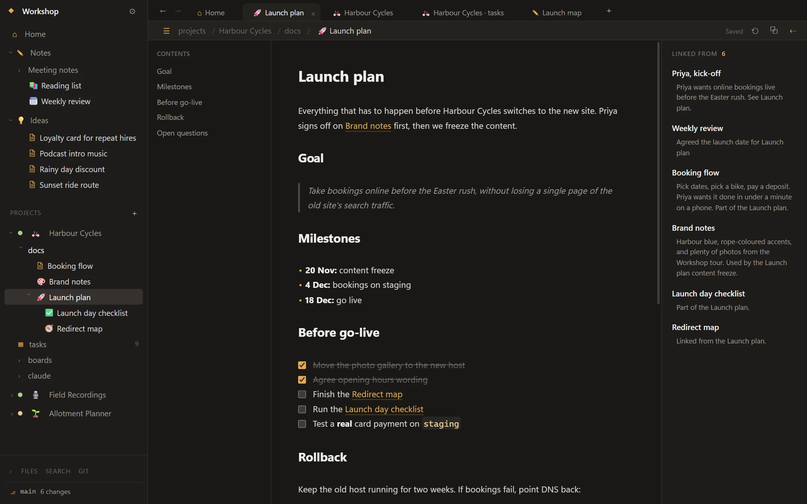

<p align="center">
  
</p>

<h1 align="center">Waypoint</h1>

<p align="center">
  Notes, projects, docs and tasks in a plain-Markdown, git-friendly vault.<br>
  <a href="https://billowper.github.io/waypoint/">Website</a> · <a href="https://github.com/billowper/waypoint/releases/latest">Download for Windows 11</a>
</p>

<picture>
  <source media="(prefers-color-scheme: light)" srcset="site/img/note-light.webp">
  
</picture>

Built with Electron, React and TypeScript.

## Run

Needs Node.js 20.19+ (22 or 26 LTS recommended).

```powershell
npm install
npm run dev        # launches the app with hot reload
npm run typecheck
npm run dist       # Windows installer in dist/
```

## What works (Phase 1)

- Open or create a vault folder (remembered between launches)
- File tree of the vault; click a `.md` file to edit, autosaves after 0.4s (Ctrl+S saves now)
- Live preview: markdown renders as you type; the line you're on shows its raw markdown
- Rename (F2, right-click, or click the title); a note's file name follows its `# title` while they match
- Drag notes and folders to move them, or right-click → Move to… / Duplicate / Delete (Recycle Bin)
- `[[Note name]]` links with autocomplete; click to follow, click a dim one to create that note;
  "Linked from" panel on the right; links update when notes are renamed or moved
- Tabs: click opens in the current tab, Ctrl+click or middle-click opens a new one; restored on relaunch
- Any tab can have its own window: right-click → Move to new window, or drag the tab out of the window
  (drop it on another window's tabs to move it there). Right-click menus throughout
- Ctrl+P finds (or creates) a note; Ctrl+Shift+F searches the text of every note
- Edits made outside the app (other editors, git) show up live
- Home page: recent notes, counts, quick actions

**Shortcuts:** Ctrl+N new note · Ctrl+P switcher · Ctrl+Shift+F search · F2 rename · Del delete
(tree item) · Ctrl+T / Ctrl+W new / close tab · Ctrl+Tab next tab · Ctrl+Shift+B linked-from panel ·
Ctrl+Shift+H home · Ctrl+F find in note

## Layout

```
src/main       Electron main process: window, vault file access, file watcher, note index
src/preload    Safe bridge exposing window.api to the UI
src/renderer   React UI (CodeMirror editor, sidebar, tabs, search, backlinks)
src/shared     Types and link/name helpers used by both sides
```

## Download

Windows installers are on the [releases page](https://github.com/billowper/waypoint/releases/latest). The installer isn't code-signed yet, so SmartScreen warns you the first time: choose More info, then Run anyway.
