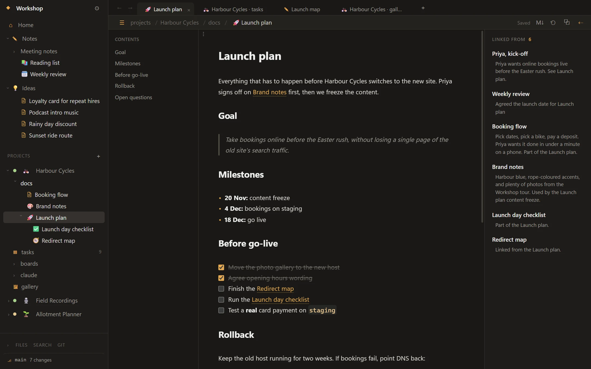
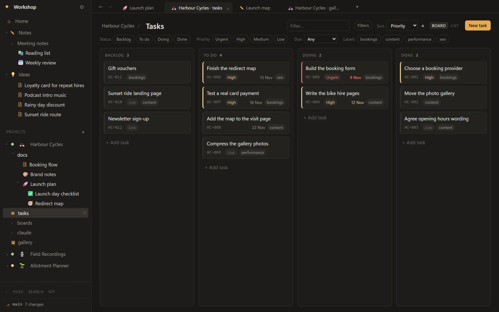
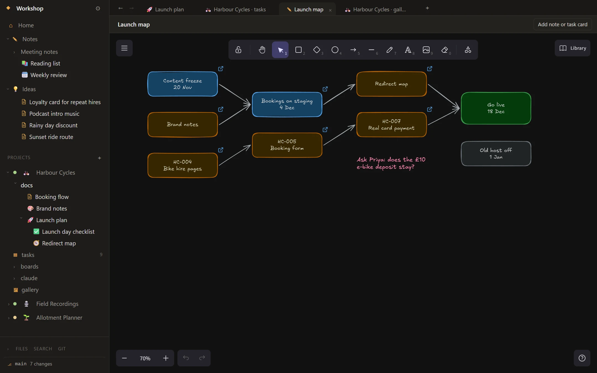
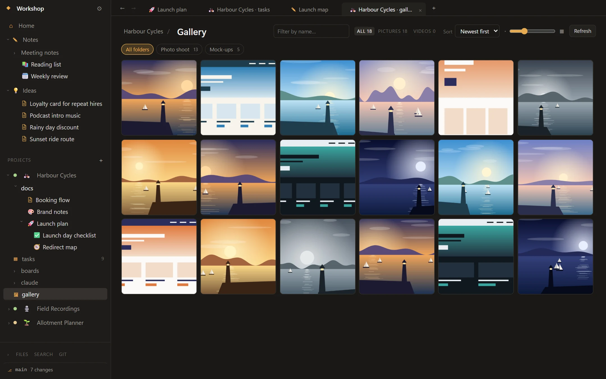

<p align="center">
  
</p>

<h1 align="center">Waypoint</h1>

<p align="center">
  Notes, projects, docs and tasks in a plain-Markdown, git-friendly vault.<br>
  <a href="https://billowper.github.io/waypoint/">Website</a> · <a href="https://github.com/billowper/waypoint/releases/latest">Download for Windows 11</a>
</p>

<blockquote>
  This is a vibe-coded Everything App with a vibe-coded README and a vibe-coded website! This started as an experiment/learning process and turned into something actually useful, so I'm sharing it. - Bill
</blockquote>

## A quick look

### Notes

Pages that read like a document and stay plain Markdown on disk, with a contents pane, nested pages and a Linked from panel.

<picture>
  <source media="(prefers-color-scheme: light)" srcset="docs/screenshots/notes-light.webp">
  
</picture>

### Tasks

A kanban board (or a list) for each project, with sorting and filters by status, priority, due date and label.

<picture>
  <source media="(prefers-color-scheme: light)" srcset="docs/screenshots/tasks-light.webp">
  
</picture>

### Boards

Excalidraw canvases, with cards that open the notes and tasks they point to.

<picture>
  <source media="(prefers-color-scheme: light)" srcset="docs/screenshots/boards-light.webp">
  
</picture>

### Gallery

Folders of pictures and videos from your PC, shown beside the project they belong to.

<picture>
  <source media="(prefers-color-scheme: light)" srcset="docs/screenshots/gallery-light.webp">
  
</picture>

## Features

- **Notes:** an editor that works like a page while every note stays plain Markdown: the marks are hidden as you type, and one click (or Ctrl+Shift+M) shows a note's Markdown. `[[wiki links]]` with autocomplete, a Linked from panel, and links that update when notes are renamed or moved.
- **Blocks and formatting:** type `/` for headings, lists, to-dos, quotes, callouts, code blocks, tables and more. Selecting text shows a toolbar, and each block has a grip for dragging it, turning it into something else, duplicating or deleting it.
- **Tables, pictures and embeds:** tables are edited in place, with Tab between cells. Paste or drop a picture and it's saved in the vault's `attachments/` folder; drag its corner to resize. `![[Another note]]` shows that note inline.
- **Nested pages:** drag a note onto another to make it a sub-page. On disk, sub-pages sit in a folder named after the note.
- **Finding things:** a quick switcher, full-text search, a contents pane, tabs, back and forward, and multiple windows.
- **Projects:** each one keeps its docs, tasks, boards and gallery together, with its status, repo, links and bookmarks.
- **Linked docs:** a project doc can show a Markdown file from the project's repo, read-only and kept up to date, instead of its own text.
- **Tasks:** a kanban board and list, with priorities, due dates and labels. Sort by priority, due date, ID or title, and filter by status, priority, due date and label; both are remembered for each project. Each task is a Markdown file.
- **Boards:** Excalidraw canvases, with cards that link back to notes and tasks.
- **Gallery:** add folders of pictures and videos to a project and browse them as a grid of thumbnails. The viewer zooms, pans, goes full screen and plays videos, and any picture can be copied as an image. The gallery only reads your folders: nothing is copied into the vault or changed on disk.
- **Git:** commit, pull and push from the sidebar, history and diffs for any note, optional auto-commit, and an optional automatic push to a remote after each one (push only: it never pulls or forces).
- **Windows 11:** a global quick-capture hotkey that files notes under Ideas, a jump list, a tray icon, notifications, and nudges about overdue work.
- **Your choice of look:** light and dark themes, an accent colour (per project if you like), fonts and interface scale.
- **Backups:** optional daily zip snapshots to a folder you choose.
- **Claude Code (optional):** a local connector lets Claude Code sessions read and update a project's tasks and docs, and you can assign a task to Claude by giving it the `claude` label. It can't delete anything, and every change is logged with undo. Waypoint never calls Claude itself, and every feature works without it.

## Your vault

A vault is a normal folder that any text editor or git client can read. Edits made outside the app show up live.

```
ideas/                  quick captures, one note each
notes/                  free-form notes, nested as deep as you like
projects/
  <project>/
    project.md          settings (frontmatter) and overview
    docs/               nested pages
    tasks/              one Markdown file per task
    boards/             .excalidraw canvases
attachments/            pictures pasted or dropped into notes
.app/                   icons, ordering and settings
```

## Download

Windows installers are on the [releases page](https://github.com/billowper/waypoint/releases/latest). The installer isn't code-signed yet, so SmartScreen warns you the first time: choose More info, then Run anyway.

## Shortcuts

| Keys | Action |
| --- | --- |
| Ctrl+Alt+W | Quick capture, from any app |
| Ctrl+Alt+F | Quick search, from any app |
| Ctrl+N | New note |
| Ctrl+P | Find or create a note |
| Ctrl+Shift+F | Search all notes |
| Ctrl+F | Find in note |
| / | Block menu, in a note |
| Ctrl+B, Ctrl+I, Ctrl+E, Ctrl+Shift+S | Bold, italic, code, strikethrough |
| Ctrl+K | Link the selection to a page or web address |
| Ctrl+Shift+Up, Ctrl+Shift+Down | Move the current block up or down |
| Ctrl+Shift+M | Show or hide a note's Markdown |
| Ctrl+Shift+H | Home |
| Ctrl+Shift+O | Contents pane |
| Ctrl+Shift+B | Linked from panel |
| Ctrl+T, Ctrl+W | New tab, close tab |
| Ctrl+Tab | Next tab |
| Alt+Left, Alt+Right | Back, forward |
| F2 | Rename |
| Del | Delete the selected tree item (to the Recycle Bin) |
| Ctrl+, | Settings |

## Build from source

Needs Node.js 20.19+ (22 or 26 LTS recommended).

```powershell
npm install
npm run dev        # launches the app with hot reload
npm run typecheck
npm run dist       # Windows installer in dist/
```

## Project layout

```
src/main       Electron main process: windows, vault file access, file watcher, search index, git, Windows integration
src/preload    Safe bridge exposing window.api to the UI
src/renderer   React UI: CodeMirror editor, sidebar, tabs, task board, canvas, gallery
src/shared     Types and helpers used by both sides
src/mcp        The optional Claude Code connector
site           The website. site/tools retakes its screenshots, and this README's, from the real app
docs           This README's screenshots
```

## Licence

[MIT](LICENSE)
